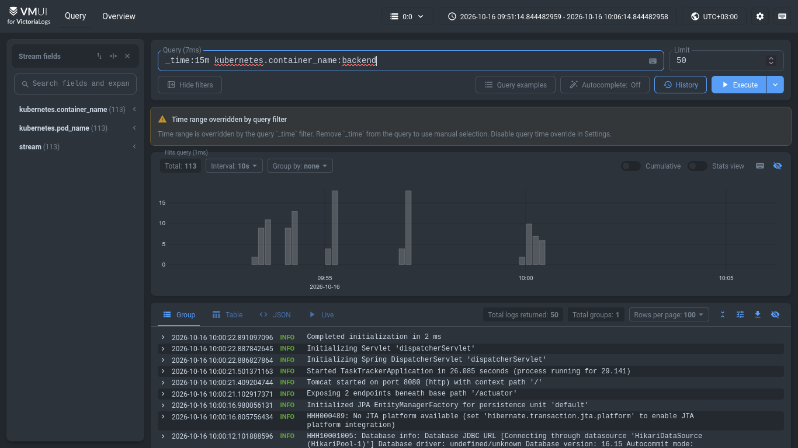
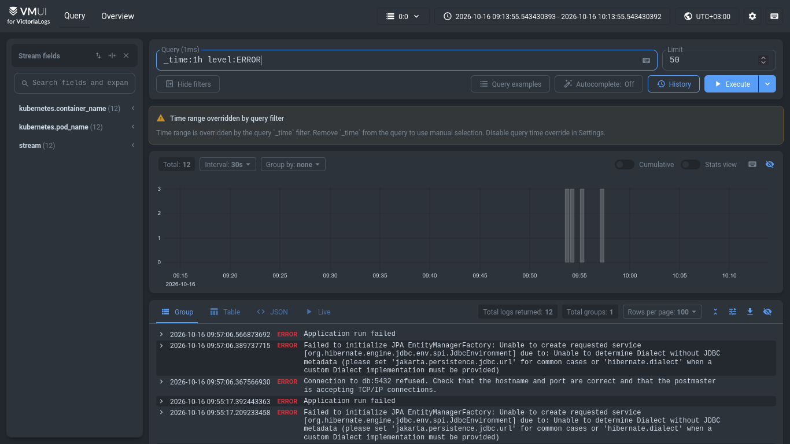
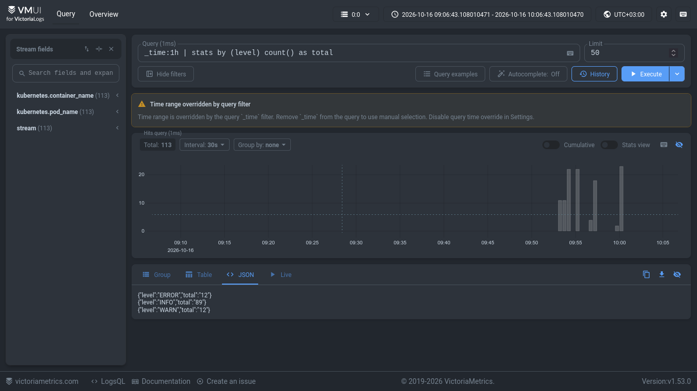
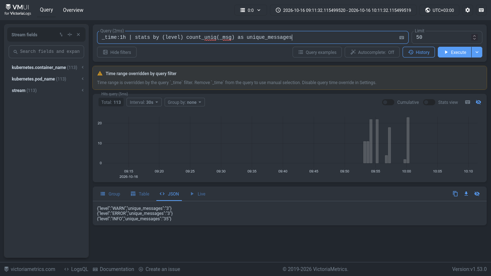

# Отчёт по ДЗ №3: Логирование

## 1. Развёртывание Victoria Logs

- Образ: `victoriametrics/victoria-logs:v1.20.0`
- Манифест: `k8s/10-victoria-logs.yaml` (Deployment + PVC 1Gi + Service ClusterIP:9428)
- Доступ к vmui: `kubectl port-forward svc/victoria-logs 9428:9428` → `http://localhost:9428/select/vmui/`

## 2. JSON-логи приложения

Spring Boot 3.5 structured logging в `application.yml`:

```yaml
logging:
  structured:
    format:
      console: logstash
    json:
      add:
        service.name: task-tracker-backend
```

Пример строки (из `kubectl logs deploy/backend`):

```json
{"@timestamp":"...","level":"INFO","message":"...","service.name":"task-tracker-backend",...}
```

## 3. Способ доставки логов

Выбран Fluent Bit DaemonSet (`k8s/11-fluent-bit-configmap.yaml` + `12-fluent-bit.yaml` + `13-fluent-bit-rbac.yaml`):

- Читает `/var/log/containers/*_task-tracker_backend-*.log` (только backend).
- Kubernetes-фильтр обогащает метаданными (`pod_name`, `container_name`, `namespace`).
- Output: `http://victoria-logs:9428/insert/jsonline?_msg_field=message&_time_field=%40timestamp`.
- HTTP JSON-lines, gzip.

## 4. LogsQL-запросы

### (а) Сырые записи

Запрос:

```logsql
_time:15m kubernetes.container_name:backend
```



Показывает: все логи backend за последние 15 минут.

### (б) Фильтр по полю

Запрос:

```logsql
_time:15m level:ERROR
```



Показывает: записи конкретного уровня.

### (в) Stats с группировкой

Запрос:

```logsql
_time:1h | stats by (level) count() as total
```



Показывает: сколько логов каждого уровня за час.

### (г) Агрегация — count_uniq

Запрос:

```logsql
_time:1h | stats by (level) count_uniq(message) as unique_messages
```



Показывает: сколько уникальных сообщений на каждый уровень. Оценка «шумности».

## 5. Артефакты

- `k8s/10-victoria-logs.yaml`
- `k8s/11-fluent-bit-configmap.yaml`
- `k8s/12-fluent-bit.yaml`
- `k8s/13-fluent-bit-rbac.yaml`
- `img/*.png`
