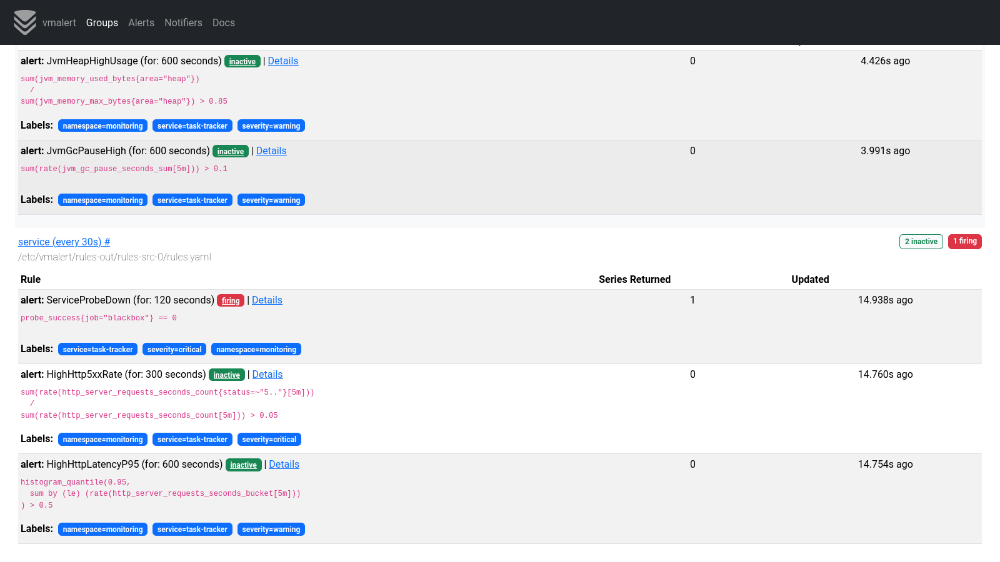
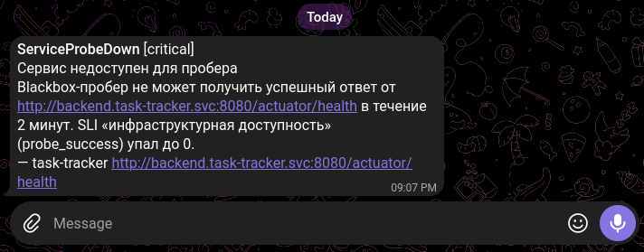

# Отчёт по ДЗ: алерты и Alertmanager

## 1. Стек и архитектура алертинга

Алертинг построен на CRD существующего victoria-metrics-operator:

```
vmagent → VictoriaMetrics ← remoteWrite ALERTS ← VMAlert ──notifier──► VMAlertmanager ──► Telegram
                ▲                  │                  │                      │
           VMRule (5 правил)  VMAlertmanagerConfig (route + telegram_configs)
                                      │
                              Secret telegram-bot (bot_token)
```

| Компонент            | Ресурс                                                                  | Файл                                                                  |
| -------------------- | ----------------------------------------------------------------------- | --------------------------------------------------------------------- |
| Правила алертов      | `VMRule/task-tracker-alerts`                                            | `k8s/30-vmrule.yaml`                                                  |
| Оценка правил        | `VMAlert/task-tracker` (eval 30s, datasource и remoteWrite → VM single) | `k8s/31-vmalert.yaml`                                                 |
| Доставка уведомлений | `VMAlertmanager/task-tracker` (prom/alertmanager v0.34.1)               | `k8s/32-vmalertmanager.yaml`                                          |
| Роутинг и Telegram   | `VMAlertmanagerConfig/task-tracker-telegram`                            | `k8s/32-vmalertmanager.yaml`                                          |
| Креды бота           | `Secret/telegram-bot` (namespace monitoring)                            | `make telegram-secret` (env `TELEGRAM_BOT_TOKEN`, `TELEGRAM_CHAT_ID`) |

Развёртывание: `make deploy` (как в ДЗ 4) + `make telegram-secret` — новые манифесты подтягиваются через `kustomization.yaml`.

## 2. Алерты на метрики сервиса (3 шт.)

### ServiceProbeDown — critical, `for: 2m`

```promql
probe_success{job="blackbox"} == 0
```

Если health-эндпоинт не отвечает 2 минуты — сервис реально недоступен для пользователя, прямое нарушение SLO 99.9% по probe. `for: 2m` отсекает одиночные сбои пробера (интервал проб — 15с, за 2 минуты ~8 неудач подряд).

### HighHttp5xxRate — critical, `for: 5m`

```promql
sum(rate(http_server_requests_seconds_count{status=~"5.."}[5m]))
  /
sum(rate(http_server_requests_seconds_count[5m])) > 0.05
```

**Почему:** при SLO 99.5% доля 5xx более 5% означает, что error budget сжигается катастрофически быстрее предусмотренного (за 5 минут — уже не единичные ошибки, а системная проблема: БД, исключения в коде). `for: 5m` даёт времени отличить всплеск от устойчивой деградации.

### HighHttpLatencyP95 — warning, `for: 10m`

```promql
histogram_quantile(0.95,
  sum by (le) (rate(http_server_requests_seconds_bucket[5m]))
) > 0.5
```

Гистограмма включена в `application.yml` (`percentiles-histogram.http.server.requests: true`), поэтому p95 считается из бакетов. `for: 10m` — warning-уровень: пользователи замечают замедление, но сервис работает.

## 3. Алерты на метрики рантайма/актуатора Spring (2 шт.)

### JvmHeapHighUsage — warning, `for: 10m`

```promql
sum(jvm_memory_used_bytes{area="heap"})
  /
sum(jvm_memory_max_bytes{area="heap"}) > 0.85
```

Heap, занятый более чем на 85% дольше 10 минут, — ранний сигнал перед OOM Kill. Алерт срабатывает до того, как Kubernetes начнёт убивать под, — есть время на диагностику (утечка, рост данных, неоптимичные запросы).

### JvmGcPauseHigh — warning, `for: 10m`

```promql
sum(rate(jvm_gc_pause_seconds_sum[5m])) > 0.1
```

Высокие паузы GC напрямую деградируют латентность и обычно предшествуют проблемам с heap. `for: 10m` исключает ложные срабатывания на кратковременных всплесках нагрузки.

## 4. Как нагрузить систему для срабатывания алертов

| Алерт                | Как спровоцировать                                                                                                                                                                              |
| -------------------- | ----------------------------------------------------------------------------------------------------------------------------------------------------------------------------------------------- |
| `ServiceProbeDown`   | `kubectl -n task-tracker scale deploy/backend --replicas=0` (через 2–3 мин алерт); вернуть: `--replicas=1` → придёт уведомление о восстановлении                                                |
| `HighHttp5xxRate`    | Остановить БД и слать запросы: `kubectl -n task-tracker scale deploy/postgres --replicas=0`, затем `while true; do curl -s localhost:8081/api/tasks >/dev/null; done` → API начнёт отдавать 5xx |
| `HighHttpLatencyP95` | Сузить CPU-лимит backend (`resources.limits.cpu: "50m"`) + интенсивный луп запросов — латентность вырастет                                                                                      |
| `JvmHeapHighUsage`   | Добавить в deployment backend env `JAVA_TOOL_OPTIONS=-Xmx128m` + луп из POST-запросов — heap быстро подойдёт к 85%                                                                              |
| `JvmGcPauseHigh`     | Тот же сценарий с маленьким heap: GC заработает в полную силу                                                                                                                                   |

После восстановления (`replicas=1`, откат env) alertmanager пришлёт `send_resolved`-уведомление.

## 5. Результат срабатывания ServiceProbeDown

Скриншот из vmalert c появлением алерта:


Скриншот из Telegram:


## 6. Итоговые файлы

```text
k8s/30-vmrule.yaml            VMRule: 5 алертов (группы service, jvm)
k8s/31-vmalert.yaml           VMAlert: eval 30s, datasource/remoteWrite → VM, notifier → alertmanager
k8s/32-vmalertmanager.yaml    VMAlertmanager + VMAlertmanagerConfig (route → telegram)
k8s/kustomization.yaml        +3 новых ресурса
Makefile                      + цель telegram-secret (Secret из env-переменных)
vmagent-values.yaml           + возвращена статическая blackbox-джоба (см. раздел 8)
```
