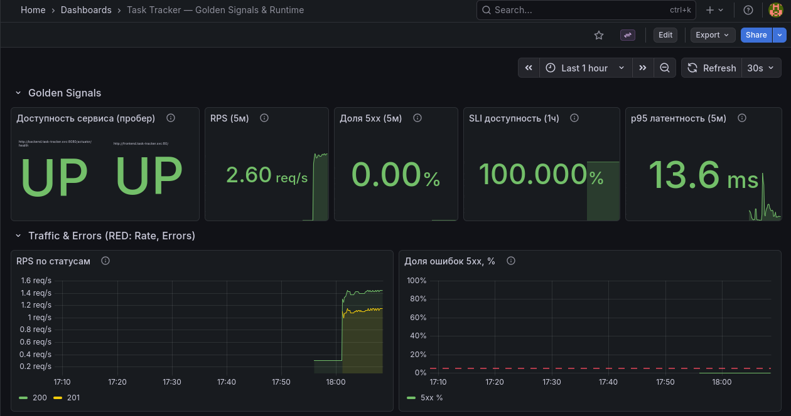
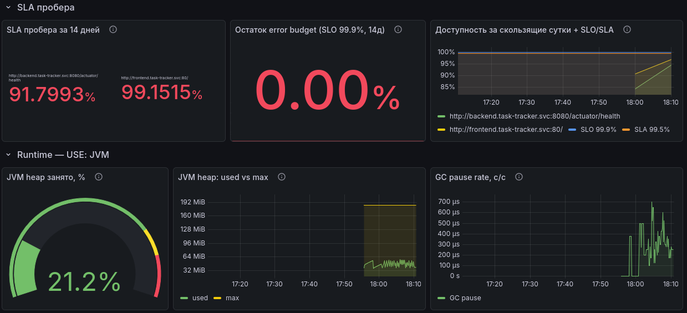
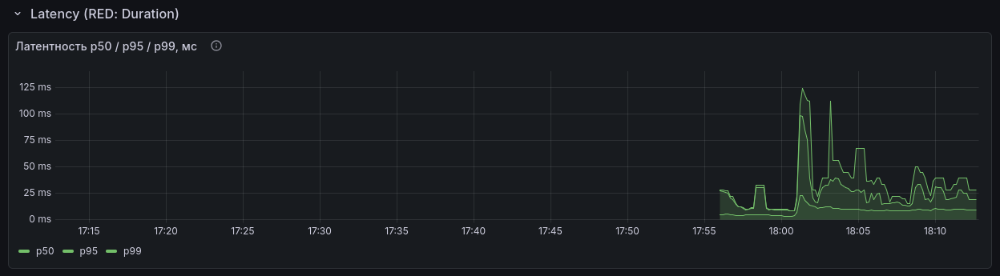
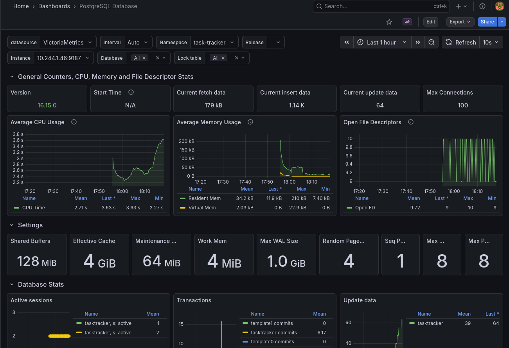

# Отчёт по ДЗ: Grafana — дашборды и визуализация

## 1. Что сделано

Поверх существующего стека (VictoriaMetrics + vmagent + VMAlert) развёрнута Grafana с
провижинингом источника данных и дашбордов:

```
                       ┌──────────────────────────────┐
  vmagent ──scrape──►  │ VictoriaMetrics single :8428 │
                       └──────────────┬───────────────┘
                                      │ Prometheus API
                       ┌──────────────▼────────────────┐
                       │  Grafana :3000 (ns monitoring)│
                       │  datasource VictoriaMetrics   │
                       │  dashboards:                  │
                       │   • Task Tracker (JSON в repo)│
                       │   • PostgreSQL Database (9628)│
                       └───────────────────────────────┘
        provisioning: ConfigMap grafana-dashboards (label grafana_dashboard=1)
                      → grafana-sc-dashboard sidecar → /tmp/dashboards
```

Источник данных указывает на `http://vm-single-victoria-metrics-single-server.monitoring.svc:8428`.
Дашборды не создаются руками: JSON лежит в git,
ConfigMap с лейблом `grafana_dashboard=1` подхватывается sidecar-контейнером и Grafana
сама перезагружает provisioning.

## 2. Дашборд приложения «Task Tracker — Golden Signals & Runtime»

28 панелей, разбиты на 7 рядов. REFRESH 30s, окно по умолчанию 6h.

### 2.1 Golden Signals (верхний уровень RED)

| Панель                       | Запрос (суть)                                                       |
| ---------------------------- | ------------------------------------------------------------------- |
| Доступность сервиса (пробер) | `probe_success{job="blackbox"}` — UP/DOWN по каждой цели            |
| RPS (5м)                     | `sum(rate(http_server_requests_seconds_count[5m]))`                 |
| Доля 5xx (5м)                | `100 * sum(rate(...{status=~"5.."})) / sum(rate(...))`, порог 5%    |
| SLI доступность (1ч)         | `100 * (1 - 5xx/all)`, линия SLO 99.5%                              |
| p95 латентность (5м)         | `histogram_quantile(0.95, sum by (le)(rate(..._bucket))) * 1000` мс |

### 2.2 Traffic & Errors, Latency

- **RPS по статусам** — `sum by (status)(rate(..._count[5m]))`;
- **Доля ошибок 5xx, %** — временной ряд с пунктирной линией SLO 5%;
- **Латентность p50/p95/p99, мс** — три квантиля из одной гистограммы, пороги 300/500 мс.

### 2.3 SLA пробера (окно 14 дней)

Retention VictoriaMetrics = **14d** (`vm-single-values.yaml`, `retentionPeriod: "14"`)
Панели ряда:

| Панель                                    | Запрос                                                                                  |
| ----------------------------------------- | --------------------------------------------------------------------------------------- |
| SLA пробера за 14 дней                    | `avg_over_time(probe_success{job="blackbox"}[14d]) * 100`                               |
| Остаток error budget (SLO 99.9%, 14д)     | `clamp(100 * (1 - (1 - avg(avg_over_time(probe_success[14d]))) / (1 - 0.999)), 0, 100)` |
| Доступность за скользящие сутки + SLO/SLA | `avg_over_time(probe_success[1d]) * 100` + `vector(99.9)` / `vector(99.5)`              |

Пороговые цвета: зелёный ≥ 99.9% (SLO), жёлтый 99.5–99.9%,
красный < 99.5% (SLA). Error budget ограничен `clamp` в диапазон 0–100%.

### 2.4 Runtime — USE (JVM / HikariCP / CPU)

| Панель                | Метрики                                                                                |
| --------------------- | -------------------------------------------------------------------------------------- |
| JVM heap занято, %    | `100 * sum(jvm_memory_used_bytes{area="heap"}) / sum(...max...)`, порог 85%            |
| JVM heap: used vs max | `jvm_memory_used_bytes`, `jvm_memory_max_bytes`                                        |
| GC pause rate, с/с    | `sum(rate(jvm_gc_pause_seconds_sum[5m]))`, порог 0.1                                   |
| JVM threads           | `jvm_threads_live_threads`, `jvm_threads_daemon_threads`, `jvm_threads_states_threads` |
| HikariCP connections  | `hikaricp_connections_{active,idle,pending,max}`                                       |
| CPU процесса, %       | `process_cpu_usage * 100`                                                              |

### 2.5 Business metrics

`tasks_in_progress` (текущая загрузка), `increase(tasks_total[5m])` (создано),
`increase(tasks_completed_total[5m])` (завершено) — стат-панели + сводный график.

## 3. Импорт готового дашборда PostgreSQL Exporter

Взят публичный дашборд **grafana.com/dashboards/9628** («PostgreSQL Database»).
JSON скачан в `grafana/dashboard-postgres.json` и изменен:

- удалён блок `__inputs`;
- ссылки `"${DS_PROMETHEUS}"` заменены на источник `VictoriaMetrics`
- задан стабильный `uid: postgres-exporter`.

Дашборд показывает `pg_up`, соединения, `pg_stat_database_*`, bgwriter, locks,
размеры БД, настройки (`pg_settings_*`), CPU/память процесса экспортера.

### Найденный и исправленный дефект инфраструктуры

При проверке дашборда `pg_up` был **0**, а экспортер писал в лог:

```
Error opening connection to database: pq: role "monitor" does not exist
```

Роль `monitor` нигде не создавалась — экспортер с ДЗ 4 фактически не работал.

Исправление:

1. `k8s/02-configmap.yaml` — добавлен `ConfigMap/postgres-init` со скриптом
   `10-monitor-role.sql`. Для новой БД скрипт выполнит сам `postgres` через
   `/docker-entrypoint-initdb.d`.
2. `k8s/03-postgres.yaml` — скрипт смонтирован в `/docker-entrypoint-initdb.d`

## 4. Скриншоты

#### Общий вид дашборда



#### SLA пробера

Низкий SLA backend — следствие инцидента из прошлого дз, когда я масштабировал `backend` до 0 и вызывал алерты.



#### Латентность и ошибки



#### PostgreSQL Exporter


