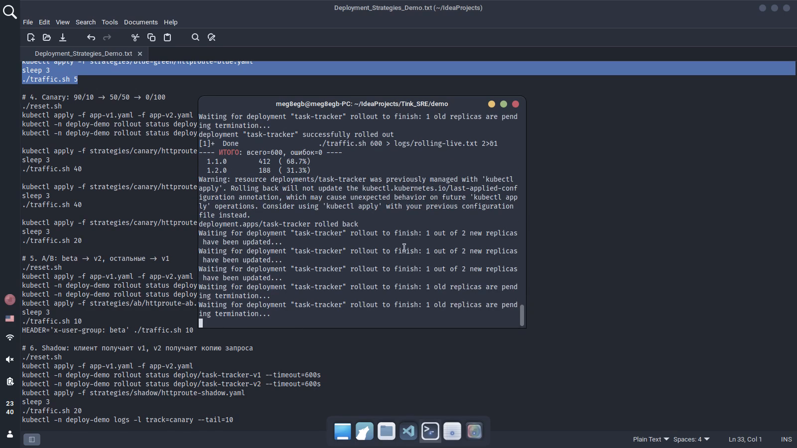
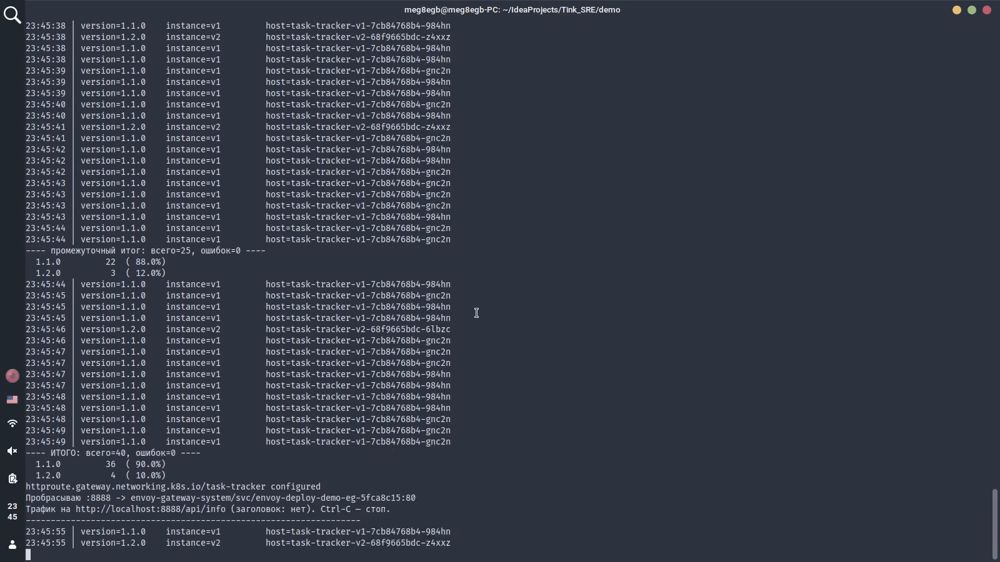
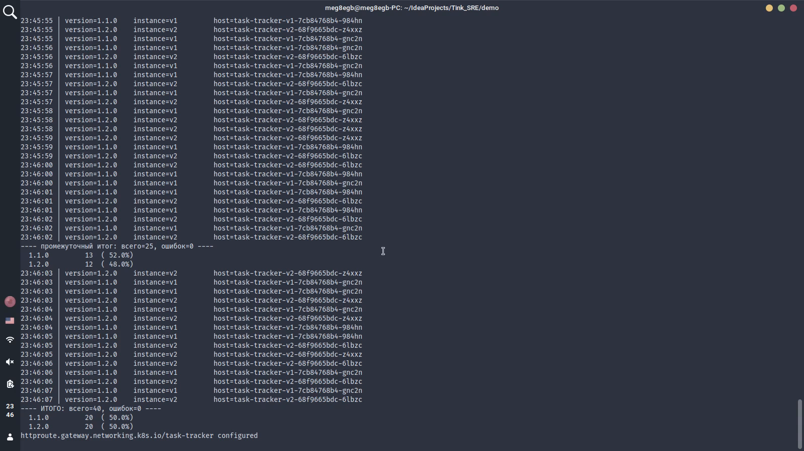
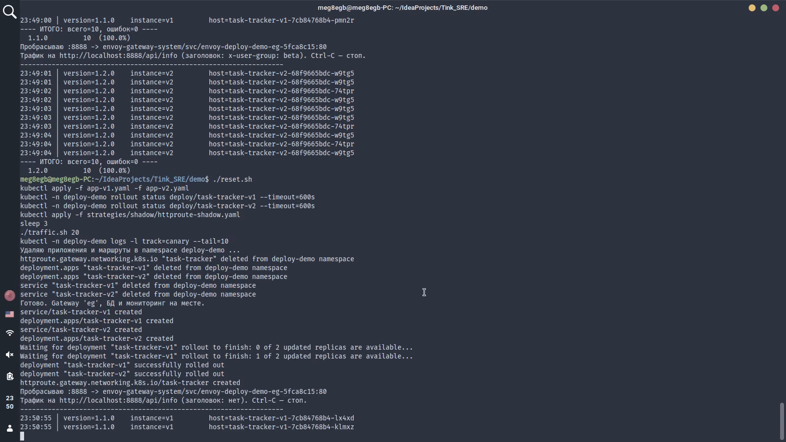
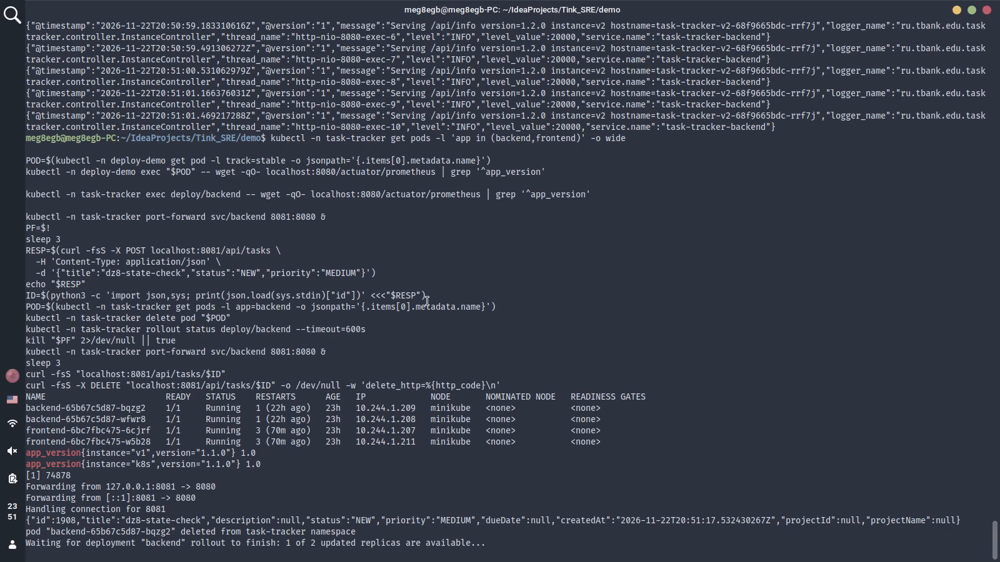
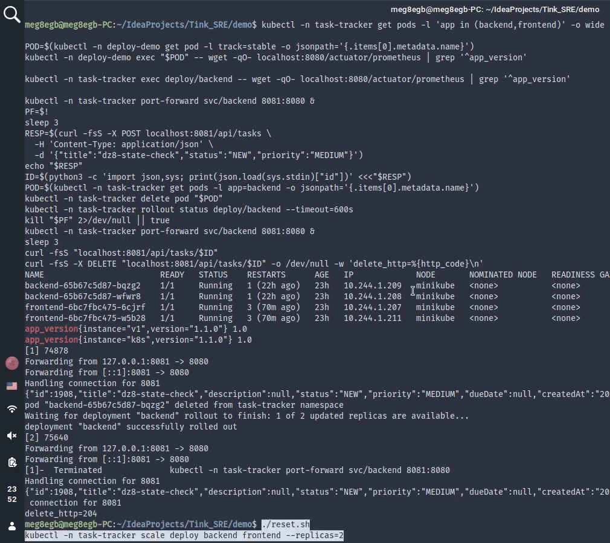

# Отчёт по ДЗ №8: стратегии развёртывания в Kubernetes

## 1. Задача и что сделано

Подготовить приложение `task-tracker` к работе в нескольких подах и провести на Envoy
Gateway (Gateway API) демо пяти стратегий деплоя: Rolling, Blue/Green, Canary, A/B,
Shadow.

- **Несколько подов**: `backend` и `frontend` подняты до `replicas: 2`.
- **Внешнее состояние**: приложение использует общую PostgreSQL `task-tracker`
  (`db:5432`), поэтому задачи хранятся в БД, а не в памяти пода.
- **Пробы**: `startupProbe` (`failureThreshold: 180`, `periodSeconds: 2` — запас 6 минут
    на JVM), `livenessProbe` и `readinessProbe` на `/actuator/health/*`; readiness включает
    проверку БД.
- **Версия приложения**: `/api/info` возвращает `application`, `version`, `instanceId`,
  `hostname`; каждый запрос пишется в INFO-лог. Добавлена метрика `app_version`.
- **Envoy Gateway** `v1.10.0`, `GatewayClass`/`Gateway` `eg` в namespace `deploy-demo`,
  весь трафик идёт через `HTTPRoute` и port-forward на Envoy-прокси.

## 2. Архитектура

```
клиент (traffic.sh, curl)
   │  http://localhost:8888/api/info
   ▼
Envoy Gateway  ──  HTTPRoute task-tracker (deploy-demo)
   │
   ├── Service task-tracker-v1 ─► Deployment v1 (1.1.0, 2 пода)
   └── Service task-tracker-v2 ─► Deployment v2 (1.2.0, 2 пода)
                    │
                    ▼
        PostgreSQL task-tracker.db.svc:5432
```

Обе версии ходят в одну БД, поэтому состояние задач переживает удаление любых подов.

## 3. Стратегии и результаты

| Стратегия      | Как реализована                                                    | Фактический результат                                                                                    |
| -------------- | ------------------------------------------------------------------ | -------------------------------------------------------------------------------------------------------- |
| **Rolling**    | один Deployment, смена образа, `maxSurge: 1` / `maxUnavailable: 0` | 600 запросов: `1.1.0` — 412 (68.7%), `1.2.0` — 188 (31.3%), ошибок 0; откат `rollout undo` → 5/5 `1.1.0` |
| **Blue/Green** | мгновенная смена `backendRefs` в HTTPRoute                         | `blue` → 10/10 `1.2.0`, `green` → 10/10 `1.1.0`, снова `blue` → 5/5 `1.2.0`, ошибок 0                    |
| **Canary**     | `weight` у backendRefs: 90/10 → 50/50 → 0/100                      | 90/10 → 36/4 (90.0%/10.0%); 50/50 → 20/20 (50.0%/50.0%); 0/100 → 20/20 `1.2.0`, ошибок 0                 |
| **A/B**        | `match` по заголовку `x-user-group: beta`                          | без заголовка → 10/10 `1.1.0`; с `beta` → 10/10 `1.2.0`, ошибок 0                                        |
| **Shadow**     | фильтр `RequestMirror` на v2                                       | клиент получает 20/20 `1.1.0`; в логах v2 — зеркальные `Serving /api/info version=1.2.0`                 |

### Rolling



Трафик шёл во время обновления (600 запросов, стратегия зашла на новый образ не сразу,
поэтому 68.7/31.3), ошибок нет. `rollout undo` вернул `1.1.0`.

### Canary





Веса в `HTTPRoute` соблюдены точно, ошибок 0 на всех шагах.

### A/B



Разделение идёт по заголовку, а не по весу: обычные клиенты получают стабильную v1,
аудитория `beta` — новую v2.

### Shadow



Клиент не видит новую версию, но v2 получает копию запроса и пишет лог — это позволяет
проверить поведение без риска для пользователя.

## 4. Проверка версии, метрик и внешнего состояния



- **Множество подов**: `backend` и `frontend` — по 2 пода, все `1/1 Running`.
- **Метрика версии** из `/actuator/prometheus`:
  - демо: `app_version{instance="v1",version="1.1.0"} 1.0`
  - основное приложение: `app_version{instance="k8s",version="1.1.0"} 1.0`
- **Внешнее состояние**: создана задача `id=1908`, затем под `backend` удалён; после
  пересоздания задача читается по-прежнему, `DELETE` возвращает `delete_http=204`.
  Состояние живёт в PostgreSQL, а не в поде.
